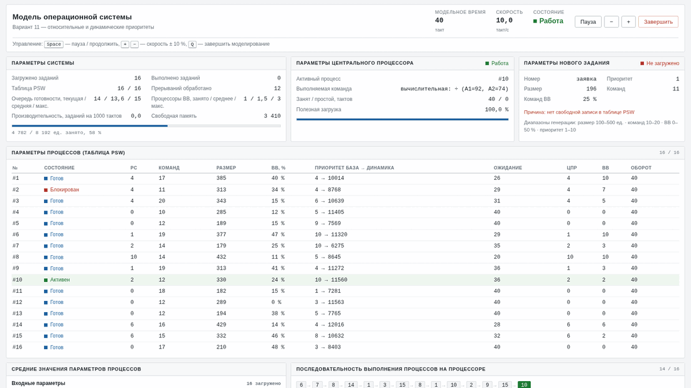
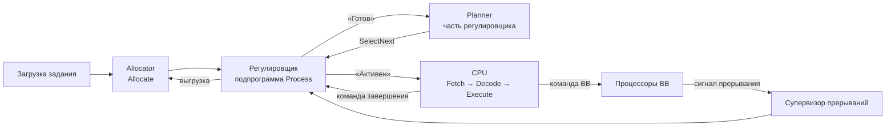

<div align="center">

# Модель операционной системы

**Вариант 11 · относительные и динамические приоритеты**

[](https://go.dev)
[](https://wails.io)


Учебная модель ОС с нативным интерфейсом: задания генерируются и загружаются
в память, планируются по динамическим относительным приоритетам и выполняются
на моделируемом фон-неймановском процессоре. Операции ввода-вывода обслуживают
процессоры ВВ, сигналы прерываний обрабатывает супервизор прерываний.

</div>



## ✨ Возможности

- **Генерация и загрузка заданий** — случайные параметры (размер, число команд,
  процент IO, базовый приоритет), проверка свободной памяти и места в таблице PSW.
- **Диспетчеризация по варианту 11** — относительные динамические приоритеты:
  активный процесс не вытесняется, приоритет растущих заданий увеличивается.
- **Фон-неймановский процессор** — `Fetch → PC+1 → Decode → Execute`, АЛУ
  выполняет двухместные операции над операндами из аппаратной памяти.
- **Регулировщик состояний** — состояния «Готов», «Активен», «Инициализация IO»,
  «Блокирован» изменяет только регулировщик (подпрограмма `Process`).
- **Ввод-вывод и прерывания** — каждой операции выделяется отдельный процессор ВВ
  (очереди к ним не моделируются); по окончании формируется сигнал прерывания,
  который обрабатывает супервизор прерываний.
- **Дашборд в реальном времени** — состояние ЦПр, память, очереди готовности,
  процессоры ВВ, журнал прерываний, полная таблица PSW, модельное время и скорость.
- **Статистика для анализа эффективности** — времена ожидания, выполнения и
  ввода-вывода, оборотное время процессов, длины очередей, полезная загрузка ЦПр,
  производительность системы, средние значения входных и выходных параметров
  процессов и последовательность выполнения процессов на ЦПр.
- **Сравнение однопрограммного и мультипрограммного режимов** — `T_mono`,
  `T_multi`, `D_exe`, `D_ready`, `M_mono`, `M_multi`, `D_multi`, `D_sys` и
  подпрограмма «Увеличить время готовых процессов».
- **Параметры из JSON-файла** — диапазоны, дискретность и комментарии для
  системных параметров и параметров заданий; файл `params.json` читается
  один раз при запуске, зерно генератора фиксировано для повторяемости.
- **Директивы оператора** — пауза, скорость, автозагрузка, ручная загрузка,
  параметры следующего задания, приостановка/возобновление и уничтожение
  выбранного процесса, изменение памяти, выполнение загруженных заданий
  с последующим выключением.
## 🧠 Как работает диспетчеризация

| Правило | Формула |
|---|---|
| Выбор процесса | `P = argmax(DynamicPriority)` — только при освобождении ЦПр |
| Приоритет (вариант 11) | `DynamicPriority += Task.Size` каждый такт в очереди |
| Свободная память | `Free = Total − Used` |

Планировщик вызывается в шаге «Проверка состояния системы»: когда активный
процесс заблокировался или завершился, либо когда ЦПр простаивает, а в очереди
появился готовый процесс (например, после прерывания от процессора ВВ).
Только регулировщик изменяет состояния процессов — планировщик лишь выбирает
номер процесса (`SelectNext`).

## 📐 Расчёт параметров в двух режимах

Для каждого процесса ведутся составляющие времени:

| Составляющая | Поле PSW | `T_mono` | `T_multi` |
|---|---|:---:|:---:|
| Загрузка задания | `LoadTicks` | + | + |
| Выполнение на ЦПр | `ExecTicks` | + | + |
| Инициализация и блокировка ВВ | `IOTicks` | + | + |
| Завершение задания | `TermTicks` | + | + |
| Переключение «Готов» → «Активен» | `SwitchTicks` | — | + |
| Логическая инициализация ВВ | `IOInitTicks` | — | + |
| Обслуживание прерывания ВВ | `IOIntrTicks` | — | + |
| Ожидание в очереди готовности | `WaitTicks + SystemWaitTicks` | — | + |

```text
T_mono(p)  = T_загр + T_ЦПр + T_ВВ + T_заверш
T_multi(p) = T_mono(p) + T_перекл + T_иниц.ВВ + T_прерыв + T_ожид
D_exe(p)   = T_multi(p) / T_mono(p) · 100 %
D_ready(p) = T_ожид(p) / T_multi(p) · 100 %

T_эфф   = T_мод + T_сист
M_multi = N_выполнено
M_mono  = T_эфф / (ΣT_mono / M_multi)
D_multi = M_multi / M_mono · 100 % = ΣT_mono / T_эфф · 100 %
D_sys   = T_сист / T_эфф · 100 %
```

Системные затраты (`T_загр`, `T_перекл`, `T_иниц.ВВ`, `T_прерыв`,
`T_заверш`) задаются диапазонами в `params.json` (лабораторная работа 8).
Подпрограмма `IncreaseReadyTime` увеличивает время всех готовых процессов
при выполнении системного действия; блокированные по ВВ процессы системное
время не получают.

## 📄 Файл параметров `params.json`

Входные параметры читаются из JSON-файла **один раз при запуске**. Для
каждого параметра задаются `min`, `max`, `step` и `comment`:

```json
{
  "seed": 2026,
  "system": {
    "memorySize": { "min": 4096, "max": 8192, "step": 1024, "comment": "Объём памяти" },
    "tickDurationMs": { "min": 10, "max": 100, "step": 10, "comment": "Длительность такта, мс" }
  },
  "task": {
    "size": { "min": 100, "max": 500, "step": 50, "comment": "Размер задания" }
  }
}
```

Полный формат и список параметров — в `docs/файл_параметров.md`.
Файл можно заменить через переменную окружения `OS_MODEL_PARAMS`; если файл
не найден, используются значения по умолчанию, а статус выводится в интерфейсе.
Фиксированное `seed` обеспечивает одинаковую последовательность параметров,
заданий и команд при каждом запуске.

## 🎛 Директивы оператора

| Клавиша | Действие |
|---|---|
| `Space` | пауза / продолжить модель |
| `+` / `−` | скорость ± 10 % |
| `A` | пауза / продолжение автозагрузки |
| `L` | загрузить новое задание |
| `P` | приостановить / возобновить выбранный процесс |
| `Delete` | уничтожить выбранный процесс |
| `F` | выполнить загруженные задания и выключить |
| `Q` | выключить питание |

Процесс выбирается щелчком по строке таблицы PSW. В панели «Директивы
оператора» можно задать параметры следующего задания, изменить объём памяти
и посмотреть результат последней директивы. Подробнее — в
`docs/директивы.md`.

Seed генератора можно переопределить ключом `-seed`:

```sh
go run ./cmd/osmodel -seed 12345
./build/bin/os_model -seed 12345
```

## 🔄 Состояния, регулировщик и прерывания

Состояния процесса: «Готов», «Активен», «Инициализация IO», «Блокирован»,
«Приостановлен».
Изменять состояние имеет право только **регулировщик** — подпрограмма
`Process(p, event)` в `internal/regulator`; процессор, подсистема ВВ и
планировщик лишь сообщают о событиях.

| Событие | Переход состояния |
|---|---|
| Загрузка задания | → «Готов» |
| Выбор планировщика | «Готов» → «Активен» |
| Команда ввода-вывода | «Активен» → «Инициализация IO» |
| Процессор ВВ начал операцию | «Инициализация IO» → «Блокирован» |
| Прерывание от ВВ | «Блокирован» → «Готов» |
| Команда завершения | выгрузка (память + запись PSW) |

По окончании операции процессор ВВ формирует **сигнал прерывания**
(`Post` в `internal/interrupt`). Супервизор прерываний извлекает сигналы
(`ExtractAll`) и через регулировщик возвращает процессы в очередь готовности.
Ход операции ВВ (номер процессора ВВ и счётчик тактов) хранится в состоянии
процессора ВВ; в PSW остаётся только состояние процесса — дублирования нет.

## ⏱ Такт моделирования

| Шаг | Действие |
|---|---|
| А | Инициализация цикла: выбор процесса, «Активен», восстановление PSW |
| Сб | Сбор статистики за такт: времена процессов, занятость ЦПр, длины очередей |
| Б1 | ЦПр выполняет очередную команду активного процесса |
| Б2 | Такт каждого процессора ВВ + обработка прерываний от ВВ |
| Б3 | Прерывания по времени — не моделируются (вариант 11: без вытеснения) |
| Б4 | Проверка состояния системы: диспетчеризация, загрузка нового задания |
| Б5 | Обновление баз данных: пересчёт динамических приоритетов |
| Б6 | Отображение изменений в состоянии системы |

## 🏗 Архитектура



| Модуль | Назначение |
|---|---|
| `internal/process` | `Task` (задание) и `PSW` (слово состояния процесса) |
| `internal/memory` | супервизор памяти: учёт свободной и занятой памяти |
| `internal/regulator` | регулировщик: единственная точка смены состояний процессов, включает планировщик `Planner` (вариант 11) |
| `internal/cpu` | процессор, АЛУ, команды и аппаратная память операндов |
| `internal/io` | процессоры ввода-вывода и сигналы по окончании операций |
| `internal/interrupt` | супервизор прерываний: накопление и обработка сигналов |
| `internal/stats` | статистика lab 6 и расчёт `T_mono`/`T_multi`, `D_exe`, `D_ready`, `M_mono`, `D_multi`, `D_sys` (lab 7) |
| `internal/params` | чтение `params.json`, хранение диапазонов и генерация значений (lab 8) |
| `internal/os` | ядро: главный цикл, генерация заданий, директивы, снимки состояния |

## 🚀 Запуск

```sh
# Режим разработки (горячая перезагрузка)
wails dev -tags webkit2_41

# Сборка приложения
wails build -tags webkit2_41
./build/bin/os_model

# Консольный режим без интерфейса
go run ./cmd/osmodel

# Другой файл параметров
go run ./cmd/osmodel -params ./params.json
```

Wails-приложение ищет `params.json` в текущем каталоге. Путь можно задать
переменной окружения:

```sh
OS_MODEL_PARAMS=/path/to/params.json ./build/bin/os_model
```

> Тег `webkit2_41` нужен для систем с WebKitGTK 4.1 (Ubuntu 22.04+, Fedora).
> На старых системах с WebKitGTK 4.0 собирайте без тега: `wails build`.

## ⌨️ Управление

| Клавиша | Действие |
|---|---|
| `Space` | пауза / продолжить |
| `+` / `−` | изменить скорость на 10 % |
| `Q` | завершить моделирование |

## 📁 Структура проекта

```
os_model/
├── main.go / app.go     # окно Wails и мост «ядро — интерфейс»
├── wails.json           # конфигурация Wails (фронтенд без сборки)
├── params.json          # диапазоны входных параметров (лаб. 8)
├── frontend/dist/       # интерфейс: HTML / CSS / JS
├── cmd/osmodel/         # консольный запуск ядра
├── internal/
│   ├── process/         # задания и слова состояний процессов
│   ├── memory/          # супервизор памяти (учёт памяти)
│   ├── regulator/       # регулировщик: состояния процессов и планировщик
│   ├── cpu/             # процессор и АЛУ
│   ├── io/              # процессоры ввода-вывода
│   ├── interrupt/       # супервизор прерываний
│   ├── stats/           # модуль статистики (лаб. 6–7)
│   ├── params/          # чтение и генерация параметров (лаб. 8)
│   └── os/              # ядро системы и снимки состояния
├── docs/                # задания к лабораторным работам
├── image.png            # скриншот интерфейса
└── go.mod
```

---

<div align="center">

Сделано в рамках лабораторных работ по дисциплине «Операционные системы» · ЧувГУ

</div>
